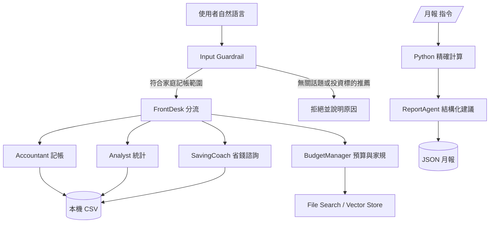

# 家庭記帳小管家｜Family Expense Assistant

使用 **Python、OpenAI Agents SDK 與多 Agent 協作**建立的家庭記帳命令列應用程式。使用者可以用自然語言記錄消費、查詢支出、比較家庭成員花費、了解家規及預算餘額，並產生附有省錢建議的月報。

> 專案定位：Python / AI Agent 實作與作品集展示。目前提供命令列介面（CLI），尚未建置公開網頁或雲端服務。

## 功能展示

| 功能 | 使用範例 | 處理方式 |
| --- | --- | --- |
| 新增消費 | `小明今天買便當 135 元` | Accountant 使用工具寫入 CSV |
| 查看帳目 | `查看最近 3 筆消費` | Accountant 讀取帳本 |
| 刪除帳目 | `刪除剛才新增的那筆` | Accountant 確認後刪除最後新增紀錄 |
| 支出統計 | `2026 年 11 月小明花了多少？` | Analyst 計算指定月份成員支出 |
| 預算餘額 | `2026 年 11 月餐飲預算還剩多少？` | BudgetManager 查詢家規、統計支出並呼叫預算計算工具 |
| 家規問答 | `家規對大筆消費有什麼規定？` | BudgetManager 透過 File Search 查詢家規 |
| 省錢諮詢 | `怎樣減少餐飲開銷？` | SavingCoach 根據消費統計提供建議 |
| 月報 | `/月報 2026-11` | Python 計算數據，ReportAgent 產生建議，儲存 JSON |

### 月報範例

以版本庫內的**虛構示範資料**為例，2026-11 月報涵蓋六類支出、各類預算、最大單筆消費與最多三項省錢建議。

| 分類 | 已支出（NT$） | 月預算（NT$） |
| --- | ---: | ---: |
| 餐飲 | 1,590 | 8,000 |
| 交通 | 1,070 | 3,000 |
| 日用品 | 1,649 | 3,000 |
| 娛樂 | 800 | 3,000 |
| 帳單 | 1,999 | 5,000 |
| 其他 | 1,000 | 2,000 |
| **總計** | **8,108** | **24,000** |

示範月報最大單筆消費為電費 1,200 元；建議內容由模型依資料產生，每次可能不同。

## Agent 協作架構



- **FrontDesk**：判斷需求，透過 handoff 將任務轉交適當專家。
- **Accountant**：新增、查看，以及刪除最後新增的消費紀錄。
- **Analyst**：依月份、分類、成員統計花費。
- **BudgetManager**：結合家規搜尋、實際支出與 Python 預算計算工具。
- **SavingCoach**：提供日常節省開銷的建議。
- **ReportAgent**：根據 Python 建立的月報產生結構化輸出；正式報告只採用 AI 產生的 `advice`，其他數值保留 Python 計算結果。
- **TopicGuard**：利用 Agents SDK Input Guardrail 阻擋無關問題與投資標的推薦要求。

**設計原則：** Agent 負責理解語意、協作和文字建議；支出統計、預算差額及月報數字由 Python 工具處理，不將模型生成金額當成權威資料。

## 使用技術

- Python 3.12+
- OpenAI API、OpenAI Agents SDK：Agent、handoff、function tools、Input Guardrail、FileSearchTool
- Pydantic：月報與護欄的結構化資料模型
- SQLiteSession：儲存對話歷史
- CSV / JSON / Markdown：帳本、月報與家規文件
- uv：套件與虛擬環境管理

## 安裝與啟動

### 1. 取得專案

```powershell
git clone https://github.com/ayuhunterx-creator/Family_Expense_Assistant.git
cd Family_Expense_Assistant
uv sync
```

需要安裝 Python 3.12 以上版本及 [uv](https://docs.astral.sh/uv/)。

### 2. 設定環境變數

在專案根目錄新增 `.env`：

```dotenv
OPENAI_API_KEY=your_api_key
OPENAI_MODEL=your_supported_model
VECTOR_STORE_ID=your_vector_store_id
```

- `OPENAI_API_KEY`：OpenAI API 金鑰。
- `OPENAI_MODEL`：可用的 OpenAI 模型名稱。
- `VECTOR_STORE_ID`：已建立並包含家規文件的 Vector Store ID。

`.env` 已由 `.gitignore` 排除，不要將 API Key 或真實家庭財務資料提交至 Git。

**注意：** 本程式在載入家規工具時要求設定 `VECTOR_STORE_ID`。只複製程式庫並執行 `uv sync`，不會自動建立雲端知識庫。使用者須在自己的 OpenAI 專案內準備 Vector Store，並上傳 `data/house_rules.md`；OpenAI API 使用可能產生費用。

### 3. 啟動

```powershell
uv run family-expense
```

範例：

```text
家庭記帳小管家已啟動

You: 2026 年 11 月餐飲花多少？
回答的 Agent: Analyst
11 月餐飲花費為 1,590 元。

You: /月報 2026-11
【月報員】2026-11
總支出：8,108 元
...
```

輸入 `exit` 或 `結束` 離開。

## 專案結構

```text
Family_Expense_Assistant/
├── src/family_expense_assistant/
│   ├── __init__.py         # CLI 入口
│   ├── main.py             # 使用者輸入、Session、/月報 指令
│   ├── agent_team.py       # AgentTeam 與 build_team()
│   ├── guardrails.py       # 輸入範圍與投資推薦檢查
│   ├── prompts.py          # BASE 與各 Agent Instructions
│   ├── expense_tools.py    # CSV 記帳與支出統計工具
│   ├── rules_tools.py      # File Search 家規查詢
│   ├── report_tools.py     # Python 月報計算與 Pydantic 模型
│   ├── monthly_report.py   # ReportAgent 與 JSON 輸出
│   └── common.py           # OpenAI 設定
├── data/
│   ├── expenses.csv        # 虛構示範消費資料（納入版本庫）
│   └── house_rules.md      # 虛構家庭規則與六分類預算
├── check_session.py        # 檢視 SQLiteSession 對話紀錄
├── setup_vector_store.py   # 更新既有 Vector Store 的家規文件
├── pyproject.toml
├── uv.lock
└── README.md
```

執行後產生的 `data/chat_history.db` 與 `data/report_YYYY-MM.json` 不納入 Git 追蹤。

## 家規與資料來源

示範家庭成員為爸爸、媽媽、小明，預算分類包含餐飲、交通、日用品、娛樂、帳單及其他。

- **帳本資料**：`data/expenses.csv`；作為新增、刪除與統計的來源。
- **月報預算數字**：Python 直接解析本機 `data/house_rules.md` 的預算表。
- **自然語言家規問答**：`rules_tools.py` 透過 OpenAI File Search 查詢 Vector Store 中的家規文件。

這兩種家規讀取方式目前並行，**更新本機 Markdown 後，仍須同步更新 Vector Store**，否則月報預算與家規問答可能使用不同版本。

`setup_vector_store.py` 用於上傳新版家規、等待索引完成後移除舊版關聯；不是每次啟動程式都要執行。

## 已知限制與後續方向

- 目前只提供 CLI，沒有網頁介面或多人同時操作機制。
- 刪除功能只支援最後新增的一筆；尚未提供任意紀錄修改或刪除。
- `add_expense()` 工具的預設成員為「我」，而 Accountant 提示詞設定預設成員為「小明」，兩者尚待統一。
- 日期、資料格式與操作權限仍可增加 Python 層級的驗證；自然語言防護不能取代程式驗證。
- 月報使用 Pydantic 結構化輸出，仍可能需要針對建議內容進一步測試。
- 家規目前有本機 Markdown 與雲端 Vector Store 兩份來源，後續可改善同步與版本管理。
- 可以增加自動化測試、清楚的操作紀錄及作品展示圖片。

## 示範資料與隱私

**`data/expenses.csv` 和 `data/house_rules.md` 均為教學用途的虛構示範資料，不代表任何真實家庭帳本或家規。**

使用真實資料前，請留意：對話內容與家規查詢會呼叫 OpenAI API；帳本與對話紀錄也會儲存在本機檔案。不要公開 API Key、個人對話紀錄或真實財務資料。

---

本專案展示從單一記帳工具，逐步整合多 Agent 分工、結構化輸出、輸入護欄、檔案搜尋與 Python 精確計算的實作過程。
